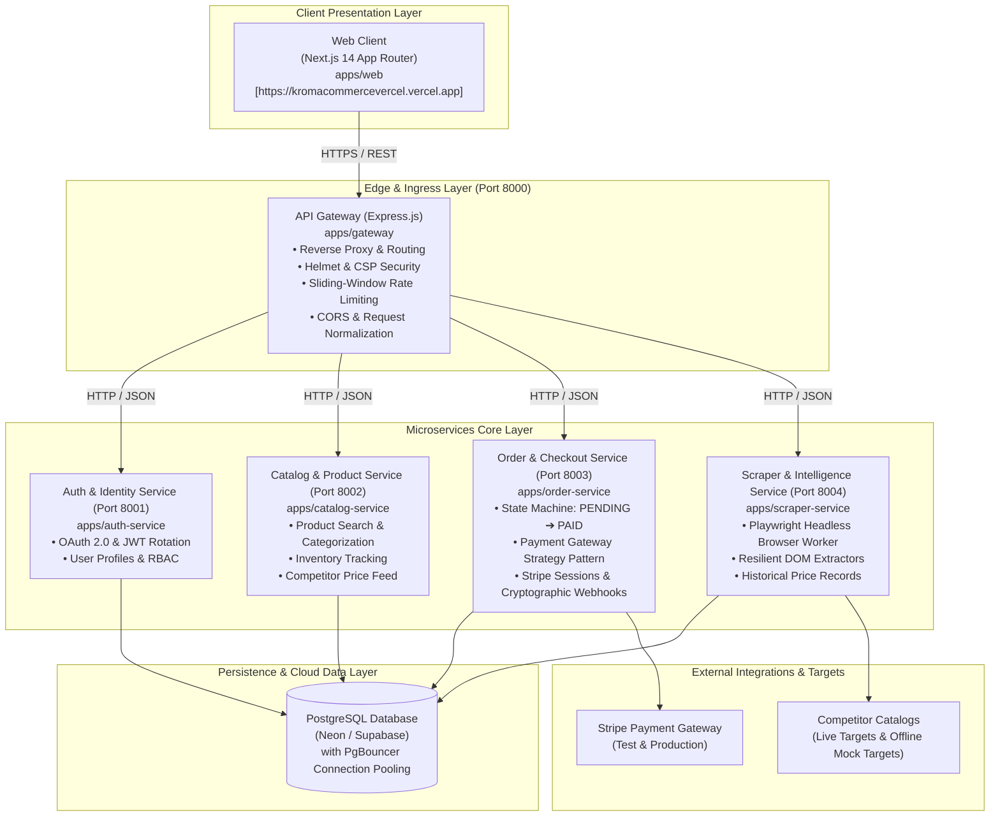

# KromaCommerce System Architecture

## 1. System Overview

**KromaCommerce** is an enterprise-grade, distributed e-commerce platform designed following strict Object-Oriented Programming (OOP) principles, clean microservice architecture, and automated competitive intelligence. The platform is engineered to run seamlessly in both **Multi-Container Microservices Mode** (Docker Compose / Kubernetes) and **Consolidated Free-Tier Container Mode** (optimized for single 512MB RAM cloud instances such as Render or Koyeb).

---

## 2. Architecture Topology

---

## 3. Microservice Specifications

### 3.1 API Gateway (`apps/gateway` - Port 8000)
- **Role:** Single public ingress point for all frontend traffic.
- **Responsibilities:**
  - Route forwarding to downstream internal microservices.
  - Defense-in-depth security via `helmet` and custom Content-Security-Policy.
  - Rate limiting with IP-based sliding window algorithm.
  - Centralized CORS validation allowing only whitelisted origins (`FRONTEND_URL`).
  - Request logging and standardized JSON error formatting.

### 3.2 Auth & Identity Service (`apps/auth-service` - Port 8001)
- **Role:** User lifecycle, authentication, and authorization.
- **Key Classes:** `AuthController`, `AuthService`, `UserRepository`.
- **Responsibilities:**
  - Secure credential registration and login with `bcryptjs` (salt rounds: 10).
  - JWT Access Token generation (15-minute lifespan) and Refresh Token rotation (7-day lifespan).
  - Cookie security: Refresh tokens delivered exclusively in `httpOnly`, `SameSite=Strict`, `Secure` cookies.
  - Role-Based Access Control (`CUSTOMER`, `ADMIN`).

### 3.3 Catalog Service (`apps/catalog-service` - Port 8002)
- **Role:** Product catalog, categories, search, and inventory management.
- **Key Classes:** `ProductController`, `ProductService`, `ProductRepository`.
- **Responsibilities:**
  - Full-text search and multi-facet filtering (category slug, price range, sorting).
  - Inventory management with atomic count tracking.
  - Real-time aggregation of competitor price records and comparison metrics.

### 3.4 Order & Checkout Service (`apps/order-service` - Port 8003)
- **Role:** Order creation, status lifecycle, and payment orchestration.
- **Key Classes:** `OrderController`, `OrderService`, `OrderRepository`, `StripePaymentGateway`, `MockPaymentGateway`.
- **Design Pattern:** **Strategy Pattern** for `IPaymentGateway`:
  - `StripePaymentGateway`: Interfaces directly with Stripe Checkout Sessions API and validates HMAC-SHA256 webhook signatures.
  - `MockPaymentGateway`: Fully deterministic, zero-latency payment simulator designed for automated CI and Playwright E2E testing without external network flakiness.
- **Responsibilities:**
  - Order creation and inventory validation.
  - Transition order state machine from `PENDING` to `PAID` upon verified webhook receipt.

### 3.5 Scraper & Intelligence Service (`apps/scraper-service` - Port 8004)
- **Role:** Competitive price monitoring and automated extraction engine.
- **Key Classes:** `ScraperController`, `ScraperService`, `BaseScraperStrategy`, `MockCompetitorStoreScraperStrategy`.
- **Responsibilities:**
  - Automated headless Chromium automation using Playwright with memory-optimized flags (`--no-sandbox`, `--disable-dev-shm-usage`, `--single-process`).
  - Extract competitor prices and calculate variance (`differencePercentage`).
  - Save historical price snapshots in `CompetitorPriceRecord`.
  - Built-in Mock Competitor Store route to provide 100% deterministic local and CI scraping without anti-bot blockage.

---

## 4. Object-Oriented Programming (OOP) Architecture

All microservices adhere to clean OOP architectural boundaries:

1. **Controller Layer (`BaseController`):**
   - Receives HTTP requests, calls validation middleware, invokes service layer, and maps outcomes to standardized HTTP response structures (`sendSuccess`, `sendCreated`, `sendPaginated`, `sendNoContent`).
2. **Service Layer (`BaseService`):**
   - Houses pure business rules, transaction coordination, and domain calculations. Interacts exclusively with repository interfaces.
3. **Repository Layer (`BaseRepository<T>`):**
   - Abstracts all database queries and Prisma ORM operations behind clear TypeScript interface contracts (`IRepository<T>`).
4. **Strategy Pattern:**
   - Swappable payment gateways via `IPaymentGateway`.
   - Swappable web scraping engines via `IScraperStrategy`.

---

## 5. Free-Tier Cloud Deployment Strategy

The system is optimized for **100% zero-cost** cloud hosting:

| Component | Target Platform | Free Tier Specifications & Strategy |
| :--- | :--- | :--- |
| **Frontend Web** | **Vercel** | Free Hobby plan. Edge CDN caching, automatic SSL, zero build cost. |
| **Backend Services** | **Render / Koyeb** | Free Web Service (512MB RAM). Supports dual execution: separate processes or single consolidated runner for zero-cost limit compliance. |
| **PostgreSQL** | **Neon / Supabase** | Free Serverless Postgres (0.5GB). PgBouncer connection pooling ensures no connection exhaustion. |
| **Storage / CDN** | **Cloudinary / Unsplash** | Free tier image hosting. |
