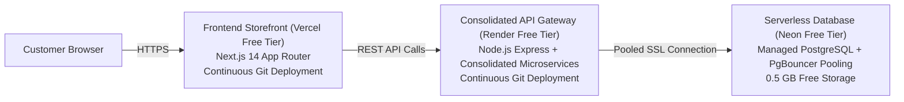

# 100% Free 3-Month Cloud Hosting Guide (Single Setup)

This guide provides the single, easiest, and completely free ($0/month, no credit card required) setup to host KromaCommerce for 3+ months with automatic continuous deployment on every code change.

---

## Architecture Overview



---

## Step 1: Create Free PostgreSQL Database on Neon (2 Minutes)

1. Go to [neon.tech](https://neon.tech) and create a free account (Sign in with GitHub).
2. Click **Create Project**, name it `kromacommerce-db`, and choose your nearest region.
3. On the project dashboard, copy the **Connection string** (ensure **Pooled connection** is selected).
   - Format: `postgresql://[user]:[password]@[endpoint]-pooler.us-east-2.aws.neon.tech/neondb?sslmode=require`
4. In your local terminal, apply the database tables and sample products to your new Neon cloud database:
   ```bash
   DATABASE_URL="your-neon-connection-string" npm run db:push
   DATABASE_URL="your-neon-connection-string" npm run db:seed
   ```
   *Your cloud database is now live with catalog inventory and test accounts!*

---

## Step 2: Deploy Backend API on Render (3 Minutes)

Render provides a free Web Service container that runs continuously and re-deploys automatically whenever you push code changes to GitHub.

1. Go to [render.com](https://render.com) and sign in with GitHub.
2. Click **New +** ➔ **Web Service**.
3. Select your KromaCommerce GitHub repository.
4. Configure the service settings:
   - **Name:** `kromacommerce-api`
   - **Environment:** `Node`
   - **Build Command:**
     ```bash
     npm install --include=dev && npm run build:backend
     ```
   - **Start Command:**
     ```bash
     npm run start --workspace=apps/gateway
     ```
   - **Instance Type:** `Free` (512 MB RAM)
5. Scroll down to **Environment Variables** and add the following 5 values:
   | Key | Value | Notes |
   | :--- | :--- | :--- |
   | `NODE_ENV` | `production` | Production mode |
   | `PORT` | `8000` | Port for incoming traffic |
   | `CONSOLIDATED_MODE` | `true` | Runs Gateway & microservices inside a single 512MB container |
   | `DATABASE_URL` | *Your Neon connection string from Step 1* | Pooled Postgres connection |
   | `JWT_ACCESS_SECRET` | *Generate a random 32-character string (e.g. `openssl rand -hex 32`)* | Access token signature |
   | `JWT_REFRESH_SECRET` | *Generate a random 32-character string (e.g. `openssl rand -hex 32`)* | Refresh token signature |
6. Click **Deploy Web Service**.
7. Once deployed, copy your backend URL (e.g. `https://kromacommerce-api.onrender.com`).

---

## Step 3: Deploy Frontend Storefront on Vercel (2 Minutes)

Vercel provides free, high-performance Next.js edge hosting with continuous deployment.

1. Go to [vercel.com](https://vercel.com) and sign in with GitHub.
2. Click **Add New...** ➔ **Project**, and select your KromaCommerce GitHub repository.
3. In the project configuration:
   - **Root Directory:** Click *Edit* and select **`apps/web`**.
   - **Framework Preset:** `Next.js` (detected automatically).
4. Expand **Environment Variables** and add:
   | Key | Value |
   | :--- | :--- |
   | `NEXT_PUBLIC_GATEWAY_URL` | *Your Render URL from Step 2 (e.g. `https://kromacommerce-api.onrender.com`)* |
5. Click **Deploy**.
6. Vercel will build and launch your store at `https://your-project.vercel.app`!

---

## How Code Updates Are Maintained

Whenever you make any code changes, bug fixes, or catalog tweaks:
```bash
git add .
git commit -m "update store features"
git push origin main
```
- **Vercel** automatically rebuilds and publishes the updated storefront in ~30 seconds.
- **Render** automatically rebuilds and restarts the backend in ~60 seconds.
- Zero manual server maintenance, zero terminal ssh required, and 100% free for the entire 3-month duration.
