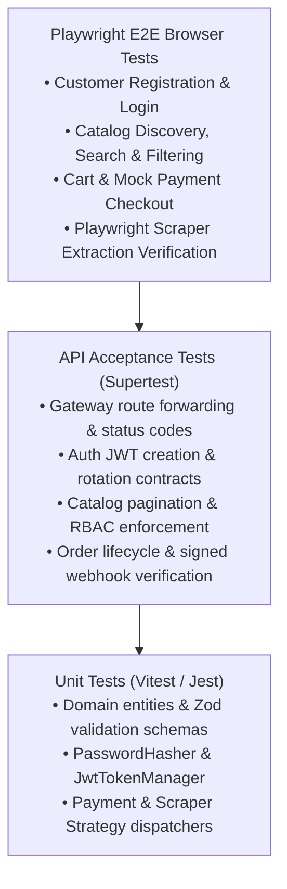

# Comprehensive Testing Strategy & Test Pyramid

## 1. Dual-Agent Separation of Concerns (Rule 7)

KromaCommerce enforces a zero-bias dual-agent QA architecture:

- **Agent 1: Development Agent (`DevAgent`)**
  - Designs microservices, domain models, database schemas, API routers, and UI components.
  - Strictly forbidden from authoring acceptance tests to prevent implementation bias.
- **Agent 2: Independent QA Agent (`TestAgent`)**
  - Treats the codebase as a black/gray box. Reads strictly from specification contracts in `/docs` and `.agent/PLAN.md`.
  - Authors independent Unit tests, Supertest API acceptance suites, and Playwright E2E browser automation journeys.

---

## 2. Automated Testing Pyramid



---

## 3. Running Automated Tests

### 3.1 Unit Tests
```bash
npm run test:unit
```
Asserts schema rejection for malformed payloads, password hash/salt verification, token expiration math, and strategy factory resolution.

### 3.2 API Acceptance Tests (Supertest)
```bash
npm run test:acceptance
```
Spins up in-process service application instances, performs HTTP assertions across all REST endpoints, and verifies response envelopes, HTTP status codes (200, 201, 400, 401, 403, 404), and cookie headers.

### 3.3 Playwright E2E Browser Automation
```bash
npm run test:e2e
```
Launches headless Chromium instances simulating user interactions across the Next.js frontend, asserting real DOM rendering, Cart calculations, mock payment checkout redirects, and live competitor price widget updates.
